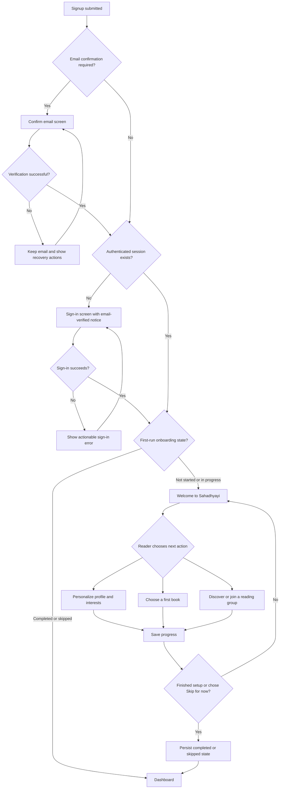

# First-Time Welcome & Reader Onboarding

**Status:** Product/UX design specification — documentation only; implementation is not included in this change  
**Created:** 2026-10-26  
**Applies to:** Sahadhyayi signup, email verification, first authenticated session, and dashboard entry

## 1. Purpose

Give newly registered readers a clear, warm introduction to Sahadhyayi after their email is verified and an authenticated session exists. Turn the first visit into a small number of useful actions without forcing people to complete a long setup form.

The design must preserve the current behavior for returning readers and must never treat a verified email as proof that the browser is authenticated.

## 2. Current behavior in the repository

The reviewed `main` branch currently implements the following:

- `/signup` sends users who need email confirmation to `/confirm-email?email=…`.
- `/confirm-email` supports a link-based verification path and manual OTP entry.
- When verification returns a session, the confirmation page displays a success state and navigates to `/dashboard` after a short countdown.
- If verification succeeds but no session is returned, the page asks the user to sign in; it does not create a session on their behalf.
- The dashboard already shows a personalized greeting and a four-item “Getting Started Checklist”: complete your profile, save a first book, start a first read, and join a group.

**Gap:** there is no dedicated first-time welcome route in the reviewed app routes. The dashboard greeting and checklist are useful, but they are not a guided welcome experience. This document describes the proposed experience; it does not claim that the new screen is already implemented.

## 3. Proposed end-to-end flowchart

The flow below is the intended behavior for implementation. It is deliberately session-aware.

### Verification and session rules

1. A successful link or OTP verification is not, by itself, sufficient to open protected content. Check the Supabase session.
2. If verification succeeds but no session is returned, show a clear “Email verified” notice and offer **Continue to sign in**. After sign-in, the first-run gate chooses the welcome page or dashboard.
3. If a link or code is expired, keep the reader on the verification route, retain the email address, explain that only the newest code should be used, and provide the supported resend flow.
4. The welcome page must not render as a protected route until the session has been restored.
5. Both email-confirmed signup and signup with confirmation disabled should converge on the same first-run decision once a valid session exists.

## 4. Screen design

### Screen A — Welcome

**Route proposal:** `/welcome` (protected; route does not exist yet)

**Headline:** “Welcome to Sahadhyayi, {firstName}!”

**Supporting copy:** “Your reading journey starts here. Make this space yours, find your next book, and meet readers who love the same ideas.”

Show a small progress indicator such as “Get started · 0 of 3” and three action cards:

| Card | Purpose | Primary action | Completion signal |
|---|---|---|---|
| Personalize your space | Set display name and optional reading interests/genres | **Personalize profile** | Valid profile changes saved |
| Find your first book | Discover or search the existing library | **Explore books** | Reader saves a book to their library/shelf |
| Find your reading people | Find relevant reading groups | **Explore groups** | Reader joins a group |

At the bottom, show **Continue to my dashboard** and a less prominent **Skip for now** link. Do not make all three cards mandatory. The reader can complete them in any order and can skip the whole experience.

### Visual direction

- Keep Sahadhyayi’s warm paper background (`#FAF7F2`), dark ink text, and restrained gold/brown accents.
- Use the existing serif heading style and rounded cards to fit the product’s reading-oriented identity.
- Use one strong primary action per card; avoid competing buttons or unnecessary animation.
- Use clear card icons, a visible progress indicator, responsive single-column layout on small screens, and keyboard-visible focus states.
- Keep the welcome page focused on the reader’s next actions. Do not show the full dashboard’s analytics and statistics before the reader is oriented.
- Provide a meaningful empty/loading/error state for profile, library, and group data. A failure in recommendations must not block “Continue to my dashboard”.

### Screen B — Dashboard after onboarding

Use the existing dashboard and checklist, with a first-time greeting such as:

> “Your reading journey starts here, {firstName}.”

Returning readers continue to see the existing contextual greeting (“Welcome back” or “Continue reading”). The four existing checklist items should remain available on the dashboard even when a user skips the welcome flow, so onboarding is optional rather than a dead end.

### Screen C — Verification succeeded, but no session

Show a confirmation state with the copy:

> **Email verified. One more step.** Your email is confirmed, but this browser is not signed in yet. Sign in to continue setting up your reading space.

Primary action: **Continue to sign in**. Preserve the email where safe/available and carry a non-sensitive “verified” UI notice through navigation. Never send the reader to a protected dashboard without a session.

## 5. Persistence and first-run decision

The decision must be durable across refreshes, browsers, and devices; do not use `localStorage` as the source of truth.

Before implementation, inspect the existing profile schema and profile creation trigger so the final migration follows the current data model. Recommended profile state:

- `onboarding_status`: `not_started`, `in_progress`, `completed`, or `skipped`.
- `onboarding_step`: the last active card/step, nullable.
- `onboarding_completed_at`: timestamp, nullable; populate for explicit completion.
- `onboarding_version`: integer to support future onboarding redesigns.

Exact column names are proposals, not claims about the current schema. Add constraints and indexes only as justified by the implementation. Update state only for the authenticated user and follow the existing RLS/profile-update pattern.

**Legacy-user protection:** before enabling a first-run gate, backfill existing profiles to `skipped` or a completed state for onboarding version 1. New profiles created after rollout should start at `not_started`. This prevents current users from unexpectedly being forced through the new journey.

Suggested behavior:
- Entering the welcome page sets status to `in_progress`.
- Completing an action updates that action’s existing product data and records progress.
- “Continue to my dashboard” marks onboarding `completed`.
- “Skip for now” marks it `skipped`; do not prompt on every subsequent sign-in.
- Readers can still finish profile/book/group tasks from dashboard checklist links after skipping.
- A later onboarding redesign can target a new version without reopening version 1 for everyone.

## 6. Routing and integration requirements

- Add a protected `/welcome` route.
- Add a single first-run decision point after auth restoration; do not duplicate the decision separately across signup, OTP, OAuth callback, and dashboard.
- On successful verification with a session, navigate to the first-run gate instead of hardcoding `/dashboard`.
- On successful sign-in, apply the same gate: new/in-progress users go to `/welcome`; completed/skipped users go to `/dashboard`.
- Ensure signup with email confirmation disabled also passes through the gate.
- Do not redirect while auth or profile state is loading. Avoid redirect loops if the profile lookup fails; show a retry path and a safe dashboard fallback rather than trapping the user.
- A valid direct visit to `/dashboard` by a first-time signed-in user should route through the same gate. Pages needed to save a book or join a group must be accessible during onboarding.
- After “Skip for now” or completion, replace the welcome route in browser history when navigating to the dashboard to avoid accidental back-button loops.

## 7. Analytics

Track the onboarding funnel using the project’s existing analytics utility where appropriate. Use event properties that do not contain email addresses, passwords, OTPs, or other personal data.

Recommended events:

- `welcome_onboarding_viewed`
- `welcome_onboarding_step_opened` (`step`)
- `welcome_onboarding_step_completed` (`step`)
- `welcome_onboarding_skipped`
- `welcome_onboarding_completed`
- Reuse existing book-save and group-join events where possible instead of creating duplicates.

Report the rate of first-time users who complete at least one action, onboarding skip rate, completion rate, and drop-off by step. Do not log raw email-verification codes or confirmation tokens.

## 8. Acceptance criteria

- [ ] A newly registered user who verifies their email and has a session sees the welcome experience before the dashboard.
- [ ] A successfully verified user without a session is sent to sign-in with a clear confirmation notice; after sign-in, routing resumes to welcome.
- [ ] Signup with email confirmation disabled still reaches welcome for a genuinely new profile.
- [ ] Returning users with completed/skipped state land on the dashboard without seeing welcome again.
- [ ] Existing accounts are backfilled or otherwise excluded from forced onboarding before rollout.
- [ ] Onboarding progress survives reload and a new browser session.
- [ ] Readers may complete cards in any order, skip optional cards, or skip the entire experience.
- [ ] Dashboard checklist items remain useful and navigable after skip/completion.
- [ ] Profile/library/group API failures do not block dashboard entry or mark an action completed incorrectly.
- [ ] Auth/profile loading states do not cause redirect loops or unauthorized access.
- [ ] Link and OTP verification flows share the same post-verification routing logic.
- [ ] Unit/integration tests cover new, in-progress, completed, skipped, no-session, profile-load-failure, and returning-user flows.
- [ ] Keyboard navigation, screen-reader labels, mobile layout, and visible focus states are validated.

## 9. Recommended implementation sequence

1. **Schema audit:** inspect profile schema, signup/profile trigger, RLS policies, auth helpers, and current tests.
2. **Persistence:** add a small migration and backfill existing users before enabling a route gate.
3. **Reusable gate:** implement one first-run routing decision after auth/profile restoration; cover signup, OTP/link, OAuth, and normal sign-in.
4. **UI:** create the protected welcome page with the three cards, progress, skip, loading, and retry states.
5. **Actions:** wire cards into existing profile, book-library, and group routes; avoid duplicating those systems.
6. **Tests:** write regression tests before rollout, particularly the no-session verification case and legacy-account behavior.
7. **Release:** deploy behind a flag or controlled rollout, monitor funnel events and auth failures, then enable for new profiles.

## 10. Related implementation files

Reviewed on the repository `main` branch on 2026-10-26:

- `src/pages/SignUp.tsx` — signup success and verification navigation.
- `src/pages/ConfirmEmail.tsx` — email link/OTP verification and current dashboard redirect.
- `src/App.tsx` — route registry and protected dashboard.
- `src/pages/Dashboard.tsx` — greeting and existing getting-started checklist.

These paths may change during implementation. Re-check current files before coding.

---

**Design decision:** treat email verification and first-run welcome as two separate milestones. Verification establishes trust in the email address; the welcome journey begins only after a valid authenticated session exists. Existing readers remain uninterrupted, and new readers get a friendly, optional path into reading, discovery, and community.
