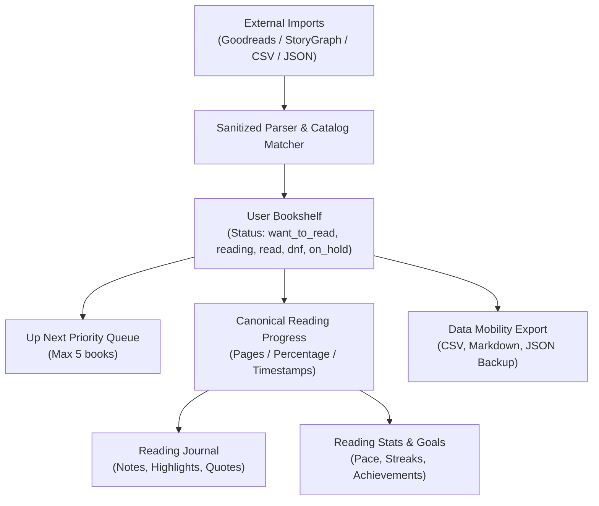

# Architecture: Reading Tracker, Progress Synchronization & Data Mobility

## 1. Domain Model Overview

The reading lifecycle in Sahadhyayi bridges digital reading (EPUB/PDF), manual reading logs, physical book tracking, and external platform migrations.

## 2. Canonical Progress Contract

To prevent race conditions, progress desynchronization, and stale overwrites across multiple client surfaces (Book Reader, Quick Update Dialog, Bookshelf Card):
1. **Source of Truth**: `user_book_progress` table or `bookshelf` canonical record keyed by `(user_id, book_id)`.
2. **Boundary Validation**:
   - $0 \le \text{current\_page} \le \text{total\_pages}$.
   - $0 \le \text{progress\_percent} \le 100$.
3. **Timestamp/Version Guard**: All progress updates supply `updated_at`. When local client time lags behind server record `updated_at`, client re-fetches and avoids overwriting newer reads from another device.
4. **Optimistic UI with Rollback**: React Query mutation optimistically updates local cache while maintaining snapshot for immediate rollback on network failure.

## 3. Data Mobility Pipeline (Import & Export)

### 3.1 Supported Schemas
- **Goodreads Export**: `Book Id, Title, Author, Additional Authors, ISBN, ISBN13, My Rating, Average Rating, Publisher, Number of Pages, Year Published, Original Publication Year, Date Read, Date Added, Bookshelves, Bookshelves with positions, Exclusive Shelf, My Review, Spoiler, Private Notes, Read Count, Recommended For, Recommended By, Owned Copies`.
- **StoryGraph Export**: `Title, Authors, Contributors, ISBN/UID, Format, Read Status, Date Added, Last Date Read, Star Rating, Review, Tags, Moods, Pace, Character- or Plot-Driven?, Strong Character Development?, Loveable Characters?, Diverse Characters?, Flawed Characters?`.
- **Generic CSV**: `Title, Author, Status, Rating, Progress, ISBN`.
- **Sahadhyayi Backup**: JSON serialization containing bookshelf, journal collections, goals, and reviews.

### 3.2 Security & CSV Injection Defense
All CSV generation and parsing implements strict RFC 4180 escaping and sanitizes leading trigger characters (`=`, `+`, `-`, `@`, `\t`, `\r`) with single-quote prefixing (`'`) to defeat formula injection in spreadsheet viewers.
